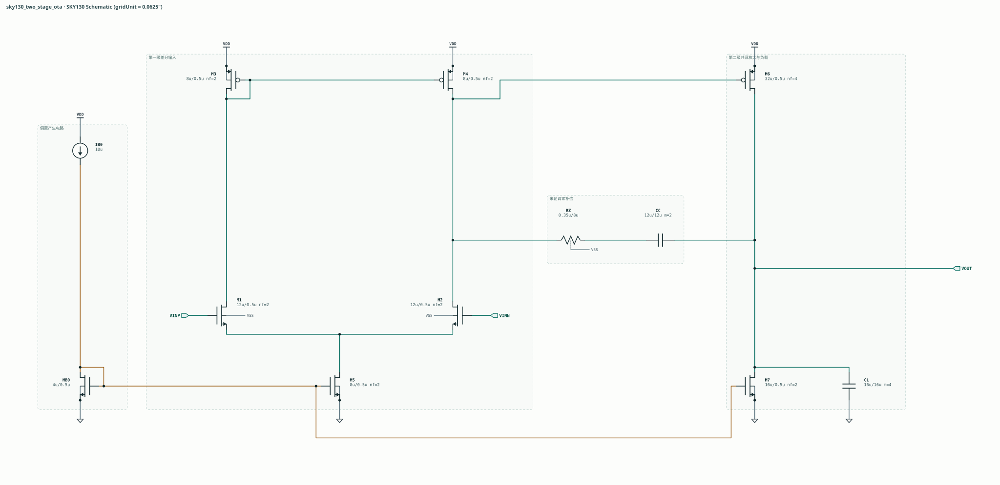

# analog-schem-gen

**PDK-Agnostic High-Readability Analog Circuit Schematic Generator & Refiner (LLM × Algorithm Co-Execution)**  
**工艺无关的高可读性模拟电路原理图生成与整理引擎（大模型 × 确定性算法协同架构）**

[](LICENSE)
[](pyproject.toml)

[English](#english) | [中文说明](#中文说明)

---

<a id="english"></a>

## Why `analog-schem-gen`?

When AI agents try to draw analog circuit schematics directly from SPICE/Spectre netlists by guessing `(x, y)` coordinates, two failure modes consistently appear:
1. **Broken connectivity**: pins miss by a single grid unit, or disconnected wire stubs fail EDA `schCheck`.
2. **Unreadable spaghetti**: parameter labels (`W/L/nf/m`) collide with adjacent transistors, global bias/supply lines cut across differential pairs, and parallel wires overlap in corridors.

`analog-schem-gen` solves this by splitting schematic generation at the **exact boundary between LLM semantic reasoning and deterministic geometric optimization**:

| Layer | Owner | Responsibility |
| :--- | :--- | :--- |
| **Circuit Semantics & Visual Critique** | **LLM Agent** | Reviews candidate motifs (`analysis.json`) and authors a **coordinate-free** `intent.json`: left-to-right functional stage order (`stage_order`), semantic device orientations (`gate_left`, `gate_right`, `horizontal_l2r`), net decluttering policies (`supply_local`, `full_wire`, `perimeter_bus`), and port placement (`near_pin`, `local_repeat`). |
| **Constrained Placement & Track Routing** | **Deterministic Engine** | Reads target PDK symbol & parameter text bounding boxes (`process-map.json`), solves **Convex Quadratic Programming (QP)** to simultaneously expand cramped clearances, compact loose intra-group gaps, and enforce **exact integer differential symmetry**, then builds **Orthogonal Steiner Trunks** with **A* obstacle-avoidance + corridor parallel track nudging (Edge Nudging)**. |
| **Electrical & Readability Gate** | **Deterministic Auditor** | Verifies LVS netlist equivalence, single-component internal wire continuity, `virtuoso-bridge-exact-schematic-v1` exact geometry compatibility, and zero symbol/label/wire collisions. |

### Sample Generated Schematics (Reference Profile: Open-Source SKY130)

**1. Two-Stage Miller-Compensated Op-Amp (12 instances · 0 DRC violations · 0 wire crossings)**



**2. Four-Tier Folded-Cascode OTA (12 instances · 0 DRC violations · 1 topological folding cross)**


### PDK-Agnostic Design

`analog-schem-gen` is **not tied to any single foundry PDK**. Target symbol pin offsets, bounding boxes, and CDF parameter names are decoupled into JSON profiles under [`pdk/`](pdk/):
- `sky130` ([`pdk/sky130_process_map.json`](pdk/sky130_process_map.json) + [`pdk/sky130_netlist_rules.json`](pdk/sky130_netlist_rules.json)) is bundled out-of-the-box as an open-source Apache-2.0 reference profile.
- Bring any custom or commercial PDK (e.g., 180nm, 65nm, 28nm) by adding a `<pdk>_process_map.json` (`virtuoso-bridge-process-map-v1`) and `<pdk>_netlist_rules.json` without changing engine code.

### Quick Start

```bash
pip install -e .

# Step 1 (Algorithm): Analyze netlist, detect motifs, and emit draft intent
python -B schem_gen.py analyze examples/sky130_two_stage_ota.spice --out work/01_analyze

# Step 2 (LLM / Designer): Refine coordinate-free intent.json (see examples/sky130_two_stage_intent.json)

# Step 3 (Algorithm): Compile exact manifest, publication SVG, and LVS/DRC audit report
python -B schem_gen.py compile examples/sky130_two_stage_ota.spice \
  --intent examples/sky130_two_stage_intent.json \
  --pdk-map pdk/sky130_process_map.json --process sky130 \
  --out work/02_compile

# Zero-shot automatic mode & existing-draft structure-preserving cleanup
python -B schem_gen.py auto examples/sky130_folded_cascode.spice --out work/fc_auto
python -B schem_gen.py refine examples/cramped_draft_manifest.json --out work/refined

# Run all 17 analytical known-solution, counterexample, and Bridge compatibility tests
python -B -m unittest discover -s tests -v
```

---

<a id="中文说明"></a>

## 中文说明

### 一、设计理念：为什么采用“模算协同”？

让大模型直接根据网表手写坐标画原理图，往往要么“引脚偏一格连不上”，要么“管子压字、偏置线横穿核心糊成一团”。`analog-schem-gen` 将流程切分为**零坐标语义意图（`intent.json`）**与**确定性几何求解**两层：

1. **大模型负责电路语义与读图审美**（见 [SKILL.md](SKILL.md) 与 [模算协同颗粒度规范](docs/模算协同颗粒度规范.md)）：
   - 审阅 `analyze` 提取的候选基元与歧义项（`ambiguitiesForLLM`）；
   - 决定功能组从左到右的信号流顺序（如 `偏置列 -> 差分输入级 -> 米勒调零补偿 -> 第二级放大 -> 输出负载`）；
   - 指定离散语义朝向（如差分对背靠背、有源镜像负载面对面共栅、米勒 `RZ+CC` 用 `horizontal_l2r` 水平跨接）与跨级偏置分流策略（`perimeter_bus` 外围母线、`near_pin` 就近贴靠端口），编译后结合 `preview.svg` 复核。
2. **确定性算法负责精确坐标与分轨走线**：
   - **双向弹性间距 + 严格整数对称**（[placer.py](schematic_gen/placer.py)）：将符号本体框与 `W/L` 参数文字框统一纳入包络，通过凸二次规划（Convex QP）同时做到“过挤处撑开、过松处收紧、组间留白”，并保证差分对与尾流管严格整数中心对称 $x_L + x_R = 2 x_{\text{tail}}$；
   - **正交 Steiner 主干 + 走廊分轨推开**（[router.py](schematic_gen/router.py)）：实现“同网共干、异网分轨（Edge Nudging）”，走廊不足时自动扩宽器件间距重排；
   - **双重签核门禁**（[auditor.py](schematic_gen/auditor.py)）：离线验证 LVS 端子网络一致性、内部网单连通分量（防止 Virtuoso `schCheck` 拆网）、`virtuoso-bridge-exact-schematic-v1` 精确几何兼容性及 6 项硬性可读性 DRC。

### 二、工艺无关架构（PDK-Agnostic）

本工具**不绑定任何特定工艺**。所有器件符号尺寸、引脚网格偏移（`pinOffsets`）与参数名映射均通过 [`pdk/`](pdk/) 下的外部 JSON 配置注入：
- 仓库默认随附开源 Apache-2.0 **SKY130** 参考配置（[`pdk/sky130_process_map.json`](pdk/sky130_process_map.json)），克隆即可直接运行演示与回归测试；
- 接入其他工艺（如 180nm / 65nm / 28nm 原厂库）时，仅需在本地提供对应的 `<process>_process_map.json` 与 `<process>_netlist_rules.json`（向真实 Virtuoso OA 库导入前可通过 `probe-pdk --live` 校验符号引脚坐标），通用引擎代码无需修改。

### 三、文档与目录导航

- **AI Agent 技能指令**：[SKILL.md](SKILL.md)
- **模算协同分工详解**：[docs/模算协同颗粒度规范.md](docs/模算协同颗粒度规范.md)
- **CLI 与 JSON 接口契约**：[docs/接口与数据结构.md](docs/接口与数据结构.md)
- **17 项已知解/反例与基准测试记录**：[VALIDATION.md](VALIDATION.md)
- **维护与边界约定**：[AGENTS.md](AGENTS.md)

## License

Licensed under the [Apache License, Version 2.0](LICENSE).
