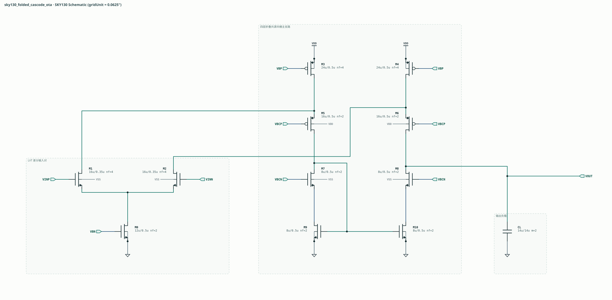
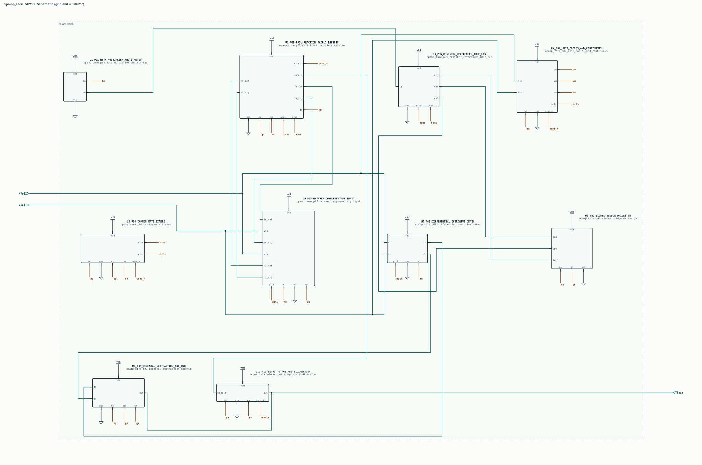
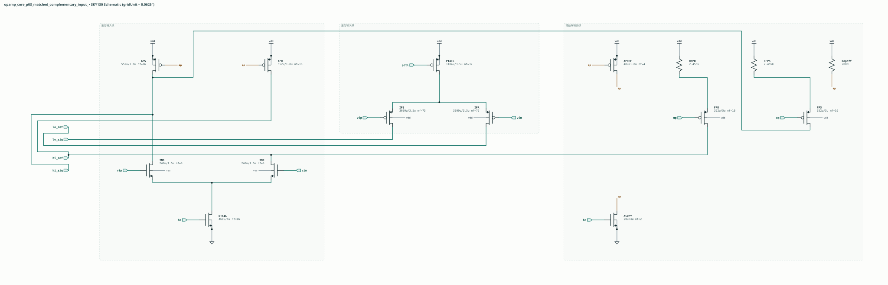

# analog-schem-gen

**Analog Circuit Schematic Generator & Refiner (LLM × Algorithm Co-Execution)**  
**模拟电路原理图生成与整理引擎（大模型 × 确定性算法协同架构）**

[](LICENSE)
[](pyproject.toml)

[English](#english) | [中文说明](#中文说明)

---

<a id="english"></a>

## Overview

Turn raw SPICE / CDL / Spectre netlists (from 10-transistor OTAs up to 160+ transistor industrial op-amps) into **clean, grid-aligned, LVS-verified schematics** — without letting LLMs guess `(x, y)` coordinates.

| Layer | Owner | Role |
| :--- | :--- | :--- |
| **Semantics (`IntentSpec`)** | **LLM / Designer** | Stage order, device orientations (`gate_left`, `horizontal_l2r`), and net decluttering policies — **zero coordinates**. |
| **Geometry & Routing** | **Deterministic Solver** | Vertical branch bundling, **Convex QP** symmetric placement, 2D aspect-ratio folding, and **two-phase Steiner + river-nested port routing**. |
| **Signoff Gate** | **Deterministic Auditor** | 1-to-1 LVS netlist check, split-net check, zero symbol/label/wire collisions, and Virtuoso-ready `manifest.json` export. |

### Three Ways to Use (No EDA Environment Required)

Runs anywhere with **Python 3.10+** (Windows / Linux / macOS, zero third-party packages, **no EDA license needed** for standalone compilation):

- **Inside AI Agents / CLI (Core Workflow)**: After tuning or generating a netlist in **Claude Code, Cursor, Antigravity, or terminal**, run one command to get clean **SVG schematics** and multi-sheet HTML books for reports, web preview, and Markdown docs.
- **Bridge into Cadence Virtuoso**: Exports exact coordinate manifests (`manifest.json`) compatible with `virtuoso-bridge` to materialize native, editable OA schematics inside Virtuoso in one click.
- **Built-In Browser Micro-Editor**: Need to nudge or flip a few devices? `export-editor` produces a single-file offline HTML canvas — open directly in any browser to drag, flip, and export updated coordinates.

## Examples (Reference Profile: SKY130)

**1. Two-Stage Miller Op-Amp (12 instances · 0 DRC · 0 wire crossings)**


**2. Folded-Cascode OTA (12 instances · 0 DRC · 1 folding cross)**



**3. 162-Instance Rail-to-Rail Class-AB Op-Amp (`OPA316` · 1 Top + 10 Subsheets · Flatten-Back LVS 100% PASS)**

*Level 0 — Synthesized Top Block Diagram (`opamp_core`):*



*Level 1 — Subsheet P03: Matched Complementary Input Pair & Degenerated Folding Branches:*



## Quick Start

### Option A: One-Prompt Setup for AI Agents (Recommended)

Paste this single prompt into **Claude Code / Cursor / Antigravity / Codex**:

```text
Clone https://github.com/neoiik/analog-schem-gen.git, install it with `pip install -e .`, read `SKILL.md`, and generate a clean schematic for <path/to/your_circuit.spice>.
```

### Option B: Manual CLI (3 Lines)

```bash
git clone https://github.com/neoiik/analog-schem-gen.git && cd analog-schem-gen
pip install -e .

# Single-sheet schematic (<= 35 instances)
analog-schem-gen auto examples/sky130_two_stage_ota.spice --out out/ota

# Multi-sheet hierarchical HTML schematic book (40-160+ instances)
analog-schem-gen hierarchy examples/sky130_rcopa316_core.spice --out out/opa316
```

<details>
<summary><strong>Advanced Commands (LLM Co-Execution, Browser Drag Editor, Draft Cleanup, Custom PDK)</strong></summary>

```bash
# Step-by-step LLM x Algorithm co-execution (analyze -> edit intent.json -> compile)
analog-schem-gen analyze examples/sky130_two_stage_ota.spice --out out/01_analyze
analog-schem-gen compile examples/sky130_two_stage_ota.spice --intent examples/sky130_two_stage_intent.json --out out/02_compile

# Export zero-dependency browser drag/flip editor -> refine modified manifest
analog-schem-gen export-editor examples/sky130_two_stage_ota.spice --out out/editor.html
analog-schem-gen refine examples/cramped_draft_manifest.json --out out/refined

# Extract PDK symbol map from Xschem .sym files (or pass --from-virtuoso --live)
analog-schem-gen extract-pdk --from-xschem /path/to/xschem/symbols --process my_pdk --out pdk/my_pdk_map.json

# Run all 26 unit & regression tests
python -B -m unittest discover -s tests -v
```
</details>

---

<a id="中文说明"></a>

## 中文说明

将无坐标的纯文本 SPICE / CDL / Spectre 网表（从十几个管子的基础运放到 160+ 器件的工业级轨到轨运放），直接编译为**对齐规整、少折点、无压字、带 LVS/DRC 校验**的原理图（SVG / 交互式多页图册 / Virtuoso 精确坐标清单）。

### 一、核心分工：模算解耦

- **大模型只做语义决策（零坐标）**：审阅拓扑基元与歧义项，指定信号流顺序（`stage_order`）、语义朝向与母线策略，不手写任何 `(x, y)` 坐标。
- **确定性算法负责排版与布线**：
  - **纵向支路自动成列 + 二维画幅折叠**：串联分压、源极退化与推挽支路自动同列垂直对齐，宽图自动双层折叠保持紧凑画幅；
  - **凸二次规划（Convex QP）**：将符号框与 `W/L` 参数文字框统一纳入包络，严格保证差分对整数中心对称 $x_L + x_R = 2 x_{\text{tail}}$；
  - **两阶段 Steiner 主干 + 端口直线对齐**：片内共线与跨组横梁先行拉通，左右端口自动重排并共线直出，消除绕背钩线与多余折点；
  - **大图层次化分页 + 展平还原 LVS**：自动保护差分对/电流镜/RC 原子簇拆分子页，合成 `TOP` 顶层框图并校验 100% 晶体管连接同构。
- **工艺无关（PDK-Agnostic）**：内置开源 **SKY130** 配置开箱即用；可通过外部 `process_map.json` 或 `extract-pdk` 接入任意 180nm/65nm/28nm 工艺及 Cadence Virtuoso。

### 二、适用环境与三种使用方式（无 IC 环境亦可独立出图）

纯 Python 3.10+ 零第三方依赖，Windows / Linux / macOS 通用；**电脑未安装 Virtuoso 或商业 PDK、手头只有一份纯文本网表时，也可 100% 离线跑通出图与 LVS 校验**：

1. **在 AI Agent / 命令行里直接用（最核心）**：在 **Claude Code、Cursor、Antigravity** 或终端里，AI 跑完仿真调好网表后，一行命令直接生成干净的 **SVG 原理图**与多页 HTML 图册（可直接用于设计报告、网页预览、Markdown 展示）。
2. **配合 Virtuoso 原生落库**：同步生成的精确坐标 JSON 清单（`manifest.json`），可通过 `virtuoso-bridge` 直接推入 **Cadence Virtuoso**，在 OA 库里一键生成原生可编辑原理图。
3. **自带轻量浏览器画布微调**：如果对某几个器件位置想手动挪一下，执行 `export-editor` 会生成一个**单文件离线 HTML**，直接在浏览器里双击点开就能拖拽、翻转器件并导出新坐标。

### 三、快速开始

#### 方式 1：让 AI 一键部署并画图（最省心）

直接将下面这段话发给 **Claude Code / Cursor / Antigravity / Codex** 等编程 Agent 即可自动装好并出图：

```text
克隆 https://github.com/neoiik/analog-schem-gen.git 并执行 pip install -e . 安装，阅读仓库根目录的 SKILL.md，把我的网表 <你的网表路径.spice> 生成为高可读原理图（若器件超过 40 个请用 hierarchy 生成多页原理图册）。
```

> 也可将本仓库直接复制到你的全局技能目录（如 `~/.claude/skills/analog-schem-gen`），之后在任意项目中对 AI 说“用 `analog-schem-gen` 把这个网表画成原理图”即可直接调用。

#### 方式 2：命令行三步运行

```bash
git clone https://github.com/neoiik/analog-schem-gen.git && cd analog-schem-gen
pip install -e .

# 中小规模网表 -> 单页 SVG + 审计报告 + Virtuoso 清单
analog-schem-gen auto examples/sky130_two_stage_ota.spice --out out/ota

# 大规模网表（40～160+ 管）-> 多页交互式 HTML 原理图册 (index.html)
analog-schem-gen hierarchy examples/sky130_rcopa316_core.spice --out out/opa316
```

### 四、文档索引

- AI 技能规范：[SKILL.md](SKILL.md)
- 模算协同与接口规范：[docs/模算协同颗粒度规范.md](docs/模算协同颗粒度规范.md) · [docs/接口与数据结构.md](docs/接口与数据结构.md)
- 演进路线与测试报告：[docs/演进路线图.md](docs/演进路线图.md) · [VALIDATION.md](VALIDATION.md)

## License

[Apache License 2.0](LICENSE)
