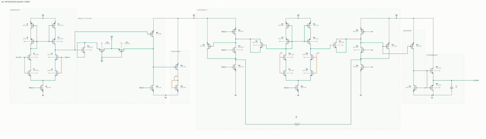

# analog-schem-gen

**Analog Circuit Schematic Generator & Refiner (LLM × Algorithm Co-Execution)**  
**模拟电路原理图生成与整理引擎（大模型语义决策 × 确定性算法排版布线）**

[](https://github.com/neoiik/analog-schem-gen/releases/tag/v0.3.3)
[](LICENSE)
[](pyproject.toml)

[English](#english) | [中文说明](#中文说明)

---

<a id="english"></a>

## Overview

Turn raw SPICE / CDL / Spectre netlists (from 10-transistor OTAs up to 160+ transistor industrial op-amps) into **clean, grid-aligned, textbook-style schematics** — without letting LLMs guess `(x, y)` coordinates.

| Layer | Owner | Role |
| :--- | :--- | :--- |
| **Semantics (`IntentSpec`)** | **LLM / Designer** | Stage order, device orientations (`gate_left`, `horizontal_l2r`), and net bus policies — **zero coordinates**. |
| **Placement & Routing** | **Deterministic Solver** | Shortest-connection 2D vertical stacking, **Convex QP** symmetric placement, collinear shared `VDD`/`VSS` rails, and orthogonal Steiner routing. |
| **Verification & Export** | **Deterministic Auditor** | Netlist connectivity & collision check, standalone SVG / multi-sheet HTML book, and Virtuoso-ready `manifest.json`. |

### What's New in v0.3.3

- **More Accurate Complex-Netlist Extraction (Coarse → Meso → Fine)**: Vertical branch folding, global bias-tree separation, on-demand local signal tracing (`inspect`), and pre-layout semantic auditing (`validate-modules`) let LLMs decompose 40–160+ transistor anonymous netlists step by step (`core anchors → modules → local skeletons`), shrink context length, and catch missing devices, torn series chains, or misplaced branches before layout.
- **Richer Analog Topology Recognition & Cleaner Schematics**: Recognizes composite analog structures including co-gated `Super-MOS` stacks, generalized horizontal Miller bridges, quasi-symmetric sandwich mirror cores, and complementary source followers; improves short-range direct wiring, wire-label stubs, long-branch vertical ordering, and intact branch protection during multi-sheet paging (41-instance dual-path op-amp: `2` wire crossings, `0` readability DRC violations).
- **Per-PDK Configuration & Reliable LLM Control**: Device families and topology thresholds are configurable per PDK; LLM net policies take top priority over the crossing optimizer, policy downgrades are explicitly reported in `audit.md`, and untouched module drafts match `auto` output exactly.

> **Note vs. Hand-Drawn Schematics**: Compared with ultra-compact schematics drawn manually by senior engineers, `analog-schem-gen` keeps complex blocks slightly more open — **prioritizing clear functional unfolding, zero overlaps, and immediately readable signal flow**. Use the built-in offline browser editor (`export-editor`) whenever tighter visual compaction is desired.

### Three Ways to Use (No EDA Environment Required)

Runs standalone on **Python 3.10+** (Windows / Linux / macOS — **no Virtuoso or commercial PDK installation required**):

1. **Inside AI Agents / CLI (Core)**: In **Claude Code, Cursor, Antigravity, or terminal**, generate clean **SVG schematics** and multi-sheet HTML books in one command right after simulation or netlist tuning.
2. **Bridge into Cadence Virtuoso**: Push the generated `manifest.json` via `virtuoso-bridge` to materialize native, editable OA schematics inside Virtuoso in one click.
3. **Built-In Browser Micro-Editor**: Run `export-editor` to get a single-file offline HTML canvas — open in any browser to drag, flip, and export updated coordinates.

## Examples (Reference Profile: SKY130)

**1. Two-Stage Miller Op-Amp**


**2. Folded-Cascode OTA**


**3. 41-Instance Dual-Path Op-Amp (Super-MOS · Generalized Miller Bridge · Sandwich Mirror Core)**



## Quick Start

### Option A: One-Prompt Setup for AI Agents (Recommended)

Paste into **Claude Code / Cursor / Antigravity / Codex**:

```text
Clone https://github.com/neoiik/analog-schem-gen.git, install it with `pip install -e .`, read `SKILL.md`, and generate a clean schematic for <path/to/your_circuit.spice>.
```

### Option B: Manual CLI

```bash
git clone https://github.com/neoiik/analog-schem-gen.git && cd analog-schem-gen
pip install -e .

# Single-sheet schematic (<= 35 instances)
analog-schem-gen auto examples/sky130_two_stage_ota.spice --out out/ota

# Multi-sheet hierarchical HTML schematic book (40-160+ instances)
analog-schem-gen hierarchy examples/sky130_rcopa316_core.spice --out out/opa316
```

<details>
<summary><strong>Advanced Commands (LLM Co-Execution, Browser Drag Editor, Draft Cleanup, Custom PDK)</strong></summary>

```bash
# Step-by-step Coarse-to-Fine LLM x Algorithm co-execution (analyze -> inspect -> validate-modules -> compile)
analog-schem-gen analyze examples/sky130_two_stage_ota.spice --out out/01_analyze
analog-schem-gen inspect examples/sky130_two_stage_ota.spice --around M1 --hops 1
analog-schem-gen validate-modules examples/sky130_two_stage_ota.spice --plan out/01_analyze/module_plan.draft.json
analog-schem-gen compile examples/sky130_two_stage_ota.spice --module-plan out/01_analyze/module_plan.draft.json --out out/02_compile
# Or compile directly from a full IntentSpec
analog-schem-gen compile examples/sky130_two_stage_ota.spice --intent examples/sky130_two_stage_intent.json --out out/02_compile_intent

# Export standalone browser drag/flip editor -> refine modified manifest
analog-schem-gen export-editor examples/sky130_two_stage_ota.spice --out out/editor.html
analog-schem-gen refine examples/cramped_draft_manifest.json --out out/refined

# Extract PDK symbol map from Xschem .sym files (or pass --from-virtuoso --live)
analog-schem-gen extract-pdk --from-xschem /path/to/xschem/symbols --process my_pdk --out pdk/my_pdk_map.json

# Run unit & regression tests
python -B -m unittest discover -s tests -v
```
</details>

---

<a id="中文说明"></a>

## 中文说明

将无坐标的纯文本 SPICE / CDL / Spectre 网表（从基础运放到 160+ 器件的复杂多级电路），自动编译为**纵向成列规整、少交叉、无压字**的原理图（SVG / 交互式多页图册 / Virtuoso 精确坐标清单）。

### 一、核心思想与 v0.3.3 更新亮点

- **大模型只做电路语义决策，确定性算法完成排版布线**：大模型按「核心锚点 → 功能模块 → 局部骨架」输出零坐标语义规划；几何坐标与正交走线全部由凸二次规划（Convex QP）与正交 Steiner 路由器精确求解。
- **v0.3.3 核心升级**：
  - **AI 看复杂网表更准**：新增竖向支路折叠、偏置剥离、局部追线聚焦（`inspect`）与布局前置校验（`validate-modules`），大幅压缩大电路上下文，并在画图前拦截漏管、拆断串联链与错分组；
  - **模拟结构识别与图面质量提升**：支持共栅叠管、广义水平 Miller 补偿桥、三明治对称核与互补源随等复合结构；优化短距实线直连、线标短桩、长支路纵层顺序及大图分页保护（实测 41 管双通路运放全图仅 2 处交叉，6 项可读性 DRC 全为 0）；
  - **多工艺适配与 AI 控制更可靠**：器件分类与拓扑阈值统一支持按工艺配置；明确 AI 策略优先级高于自动优化器，策略降级会在报告中显式提示，确保未改动草案与一键 `auto` 效果一致。
- **与手工绘制原理图的差异**：与资深工程师极致紧凑的手绘图相比，当前工具在复杂模块上略偏舒展，**优先保证功能层级清晰展开、零重叠压字与信号流一目了然**；如需进一步收紧版面，可配合自带离线编辑器（`export-editor`）微调。

### 二、适用环境与三种使用方式（无 IC 环境亦可独立出图）

基于 **Python 3.10+** 跨平台运行（Windows / Linux / macOS），**无需安装 Virtuoso 或任何商业 EDA / PDK 环境，只有纯文本网表即可直接出图**：

1. **在 AI Agent / 命令行里直接用（最核心）**：在 **Claude Code、Cursor、Antigravity** 或终端里，AI 跑完仿真调好网表后，一行命令直接生成干净的 **SVG 原理图**与多页 HTML 图册（用于报告、网页预览、Markdown 展示）。
2. **配合 Virtuoso 用**：生成的精确坐标 JSON 清单（`manifest.json`），可通过 `virtuoso-bridge` 直接推入 **Cadence Virtuoso**，在 OA 库里一键生成原生可编辑原理图。
3. **自带轻量浏览器画布微调**：如果对某几个器件位置想手动挪一下，执行 `export-editor` 会生成一个**单文件离线 HTML**，直接在浏览器里点开就能拖拽、翻转并导出新坐标。

### 三、快速开始

#### 方式 1：让 AI 一键部署并画图（推荐）

将下面这段话发给 **Claude Code / Cursor / Antigravity / Codex** 等 Agent：

```text
克隆 https://github.com/neoiik/analog-schem-gen.git 并执行 pip install -e . 安装，阅读仓库根目录的 SKILL.md，把我的网表 <你的网表路径.spice> 生成为高可读原理图（若器件超过 40 个请用 hierarchy 生成多页原理图册）。
```

#### 方式 2：命令行运行

```bash
git clone https://github.com/neoiik/analog-schem-gen.git && cd analog-schem-gen
pip install -e .

# 单页原理图 (SVG + Virtuoso 清单)
analog-schem-gen auto examples/sky130_two_stage_ota.spice --out out/ota

# 大规模网表多页交互式原理图册 (index.html)
analog-schem-gen hierarchy examples/sky130_rcopa316_core.spice --out out/opa316
```

### 四、文档索引

- AI 技能规范：[SKILL.md](SKILL.md)
- 模算协同与接口规范：[docs/模算协同颗粒度规范.md](docs/模算协同颗粒度规范.md) · [docs/接口与数据结构.md](docs/接口与数据结构.md)
- 演进路线与测试报告：[docs/演进路线图.md](docs/演进路线图.md) · [VALIDATION.md](VALIDATION.md)

## License

[Apache License 2.0](LICENSE)
