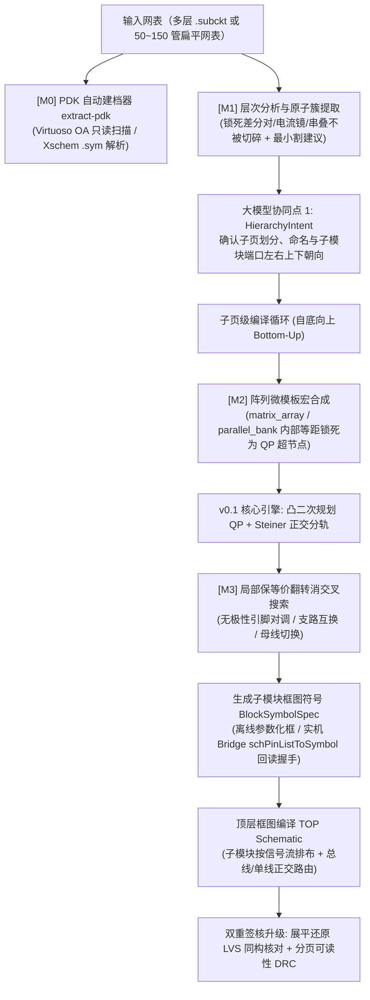

# `analog-schem-gen` v0.2 演进方向详细方案设计

> 状态：方案设计稿（待评审确认后分阶段实施，当前 `v0.1.0` 核心代码未改动）  
> 目标：在不牺牲 `v0.1.0` 确定性几何与可读性 DRC 质量的前提下，突破 **40～150+ 管复杂模拟/混合信号大图**、**规整阵列（CDAC/电阻串/多指并联组）**、**自动局部消交叉** 与 **任意新 PDK 快速建档接入** 四大场景。

---

## 一、全局架构演进总览

`v0.1.0` 解决了**单页模拟叶单元（2～35 管）**的模算协同排图；`v0.2` 在其外围增加 **“自顶向下切分（Partitioning）+ 刚体阵列宏（Array Macro）+ 局部翻转消交叉（Flip Search）+ 自底向上符号组装（Bottom-Up Symbol Assembly）”** 闭环：



---

## 二、模块一：面向 40～150+ 管大图的层次化分页与符号组装（M1）

### 1. 两种输入形态的统一处理
- **原生层次化网表（含多个 `.subckt`）**：解析器由单单元 `NetlistCircuit` 升级为多单元有向无环图 `NetlistDesign`（按实例引用关系拓扑排序，叶单元在前，顶层在后）。
- **单张大扁平网表（Flat Netlist，器件数 $> 35$）**：不强行挤在一张画布上，而是通过**虚拟子电路提升（Virtual Outlining）**先拆成 $3 \sim 6$ 张高可读性功能子页 + $1$ 张顶层信号流总图。

### 2. 模算协同颗粒度设计（防切碎机制）
纯图分割算法（如谱聚类或 Metis）直接跑在晶体管级网表上，常犯的致命错误是把一对共栅电流镜或跨导差分对切成两半。因此采用**两步模算协同**：
1. **算法先做（确定性不可切原子簇 `AtomicCluster`）**：
   - 先剔除全局 `VDD`/`VSS` 节点，将 `diff_pair`（含尾流管与有源负载）、同轨 `current_mirror`、`cascode_pair`、`rc_series` 缩点凝聚为**不可分割超节点**；
   - 在超节点图上按信号流与共享偏置计算候选社区（控制每页目标规模为 $8 \sim 25$ 个器件），输出 `partition.draft.json`（含跨页割边网络数统计）。
2. **大模型判断（`HierarchyIntent`）**：
   - 审阅并命名各子页（例如 `01_bias_gen`、`02_folded_input`、`03_ab_output`、`04_cmfb_startup`）；
   - 修正边界器件归属（如将启动管归入偏置页而非主放大页）；
   - 为每个子页的对外端口指定符号边归属（`left` 输入、`right` 输出、`top` 电源、`bottom` 地/偏置输入）。

### 3. 与 `virtuoso-bridge-lite` 的实机“符号回读三步握手”（关键防坑设计）
核查本机 `virtuoso-bridge-lite` 源码可知：
- Bridge 已内置原生符号生成能力 `symbol_generate_from_schematic_skill(..., sort_pins="geometric")`（调用 Cadence `schSchemToPinList` + `schPinListToSymbol`，自动按子原理图端口的几何方位摆放 Symbol 引脚）；
- 但 `manifest.py` 在导入顶层原理图时会执行严格门禁 `validate_process_master_offsets`——若离线预估的子模块 Symbol 引脚坐标与 Cadence 实际生成的 Symbol 差半格，导入会立即报错中止。

为此设计**离线与实机双态无缝协议**：
- **离线预览态（纯本地）**：由内置 `BlockSymbolSynthesizer` 按左/右/上/下引脚数自动生成标准网格矩形框（引脚间距固定 `4` 格，框宽 `12` 格），写入临时 `hierarchy_process_map.json` 供 `TOP` 编译与 SVG 渲染。
- **实机 Virtuoso 落库态（Bottom-Up 三步握手）**：
  1. 依次导入全部子页 `schematic` 视图并通过两轮 `schCheck`；
  2. 对每个子页调用 `symbol_generate_from_schematic_skill(..., sort_pins="geometric")` 生成原生 `symbol` 视图，随即调用只读探测读回该 `symbol` 的**真实 `pinOffsets` 与 `bBox`**；
  3. 将真实 `pinOffsets` 自动回填至 `TOP` 的 `process-map`，重新执行一次耗时 `< 0.1s` 的 `compile(TOP)`，再导入 `TOP/schematic`。既 100% 满足 Bridge 严格引脚核验，又彻底免除人工画 Symbol。

### 4. 电气等价守恒升级：展平还原 LVS（Flatten-Back Equivalence）
对于由扁平大网表虚拟分页生成的层次化清单，审计器将 `TOP` 及所有子页按端口映射**在内存中重新展平为单层晶体管网表**，与原始输入扁平网表做双射图同构及参数比对，保证拆页过程**零漏网、零错接、零体端遗失**。

---

## 三、模块二：规整阵列与并联组微模板（M2 · 吸收 `cdl_gen` 强项）

### 1. 适用电路结构
- 二进制/温度计电容阵列（如 SAR ADC 的 `CDAC`：`C_dum, C0, C1, ..., C7` + 底极板开关阵列）；
- 串联分压电阻梯（R-string / R-2R Ladder，支持直线排列或蛇形折叠 `serpentine`）；
- 多支路并联电流舵 / 多路偏置电流源排（`IB_0 .. IB_7`）；
- 带左右 Dummy 管护卫的精密匹配器件排。

### 2. 数据契约扩展（`intent.json` 中的 `motifs`）
大模型无须手算阵列每个单元的坐标，只需声明阵列结构与排列序：

```json
{
  "type": "parallel_bank",
  "id": "cdac_main_bank",
  "instances": ["CDUM", "C0", "C1", "C2", "C3", "C4"],
  "orientation": "vertical",
  "pitchX": 9,
  "commonTopNet": "VTOP_SUM",
  "bottomTapStyle": "bus_ripper",
  "busName": "VBOT<4:0>"
}
```
或二维矩阵 / 蛇形电阻串：
```json
{
  "type": "serpentine_chain",
  "id": "r_ladder_16",
  "instances": ["R1", "R2", "R3", "R4", "R5", "R6", "R7", "R8"],
  "columns": 4,
  "rowsPerColumn": 2
}
```

### 3. 刚体超节点嵌入 QP（Rigid Macro Supernode）
- **内部确定性生成**：阵列内部各器件相对锚点 $(X_0, Y_0)$ 的偏移 $(dx_k, dy_k)$ 以及公共顶极板水平母线、相邻串联短接线由**专用阵列微生成器**直接按整数网格算出，不进入通用 A* 搜索。
- **外部弹性协同**：在 `placer.py` 的全局凸二次规划中，整个阵列折叠为一个刚体变量 $X_{\text{bank}}, Y_{\text{bank}}$，其外包络为全体成员（含各自参数文字框）的并集包络，与周围运放、比较器自然保持组间留白。
- **总线束渲染（Bus Bundle & Ripper）**：对 `SW<7:0>` 等并行控制线，支持以一条粗母线（Bus Line）加 `45°` 分线斜标（Bus Tap）接入阵列底端，大幅降低图面平行线密度（导出 Virtuoso 清单时可按选项展开为标准命名网络或总线端口）。

---

## 四、模块三：保等价局部翻转消交叉与受控短桩标签（M3）

### 1. 自动局部离散消交叉（Bounded Local Symmetry / Flip Search）
在 `compile` 完成初版布局布线后，若 `wireCrossingCount > 0`，在不违背大模型指定的核心阅读序（`stage_order`）和锁定对称组（`diff_pair`）的前提下，算法自动探索有限合法邻域：

| 允许的局部离散动作 | 电学合法性前提 | 典型收益场景 |
| :--- | :--- | :--- |
| 无极性二端无源器件 `P ↔ M` 翻转 | 对称理想电阻/电容（不含三端带衬底 `B` 或极性电容） | 消除跨接 RC 两端引出线的自交扭结 |
| 独立单管 `gate_left ↔ gate_right` 镜像 | 该管不属于已锁定朝向的 `diff_pair` | 让二级放大管或缓冲管栅极朝向来线方向 |
| 同组同层无序支路相邻列互换 | 两支路同属一个 `group` 且未被 `columnOrderHints` 硬锁死 | 消除多路电流镜输出支路的交叉排列 |
| 跨 $\ge 3$ 组非关键网络切换 `perimeter_bus` | 非主信号链网络 | 将横穿放大核心的偏置线移入底部母线槽 |

代价函数严格按字典序下降，确保绝不引入任何硬性 DRC 违例：
$$\mathcal{J}(S) = 10^5 \cdot N_{\text{DRC}}(S) + 100 \cdot N_{\text{cross}}(S) + 8 \cdot N_{\text{bend}}(S) + L_{\text{wire}}(S)$$
单次迭代仅重跑受影响网络的子树路由，控制在 `< 1s` 内完成。

### 2. 受控短桩网络标签（Verified Wire-Label Stubs）
- **问题**：对于跨全图的数字使能（`EN`、`EN_B`、`PWRDN`）或修调位（`TRIM_0..3`），即使走外围母线也会拉出很长的边框线。
- **双轨安全设计**：
  - 在 `netPolicies` 中新增 `"label_stub"` 选项：仅当用户明确开启 `--allow-wire-labels`（用于 SVG 出图，或配合 `virtuoso-bridge-lite` 的轻量 `schCreateWireLabel` 扩展脚本落库）时启用；
  - 若目标为严格原版 `virtuoso-bridge-exact-schematic-v1`（不含内部网 wire label 原语），编译器自动将 `"label_stub"` 安全回退为 `"perimeter_bus"`，确保 Virtuoso `schCheck` 永远不断网报错。

---

## 五、模块四：一键 PDK 自动建档与可视化微调往返（M4）

### 1. `extract-pdk` 只读自动建档子命令
为彻底消除接入新工艺时手工测量 `pinOffsets` 和 `bodyBox` 的门槛，新增两条纯只读提取管线：
1. **Virtuoso 实装库只读扫描（`extract-pdk --from-virtuoso`）**：
   - 输入一个简单的器件映射表（如 `nmos -> smic18mmrf/n18`, `pmos -> smic18mmrf/p18`）；
   - 通过 Bridge 只读读取每个 `symbol` 的 `bBox`、各 terminal 引脚框中心（折算为 `gridUnit` 整数/半格倍数）及 `cdfGetCellCDF` 参数名，直接生成立即可用的 `<pdk>_process_map.json`（商业工艺配置保存在具体项目目录，不进入本开源仓库）。
2. **Xschem `.sym` 离线解析（`extract-pdk --from-xschem`）**：
   - 面向开源工艺（`sky130`、`gf180mcu`、`ihp-sg13g2`），离线解析 `.sym` 文件中的引脚坐标框与 SPICE 格式化模板，批量扩充开源内置参考库。

### 2. 人机交互微调闭环（Interactive Canvas Round-Trip）
- 新增 `export-editor` 输出一个零依赖单文件 `editor.html`：支持在浏览器里直接用鼠标拖动器件或功能框、按键翻转 `R0/MY` 朝向，实时显示飞线橡皮筋（Rubber-band），一键保存调整后的 `draft_manifest.json`；
- 再调用 `schem_gen.py refine draft_manifest.json --out final/`，由 QP 精确吸附网格、撑开文字净空并重走正交分轨实线，实现 **“算法自动出 90 分图 → 人拖拽微调 30 秒 → 算法收敛至 99 分入库”**。

---

## 六、分阶段实施里程碑与验收标准

建议按投入产出比最高、风险最低的顺序分 **三期（Phase 2.1 → 2.3）** 落地：

| 阶段 | 包含内容 | 关键验收指标（纯数据测试 + 基准电路） |
| :--- | :--- | :--- |
| **Phase 2.1（最高优先：阵列宏 + 局部消交叉）** | 实现 **M2**（`parallel_bank` / `serpentine_chain` 刚体超节点 + 总线分线器渲染）与 **M3**（局部保等价翻转消交叉搜索） | 1) 新增 8-bit `SKY130` 开关电容阵列（CDAC）与 8 级电阻串基准网表，阵列内部严格等距、0 违例；<br>2) 构造故意反转支路朝向的运放反例，验证局部搜索自动将交叉数从 $\ge 3$ 降至 $0$。 |
| **Phase 2.2（核心突破：50～100+ 管层次化分页与符号组装）** | 实现 **M1**（多 `.subckt` DAG 解析 + 扁平大图原子簇保护分页 `HierarchyIntent` + `BlockSymbolSynthesizer` + 展平还原 LVS 核对 + 实机三步握手接口） | 1) 构建 60+ 管带偏置树、折叠共源共栅主核、AB 类输出级与 CMFB 的完整运放基准网表；<br>2) 验证拆分为 4 张子页 + 1 张 `TOP` 框图后，展平还原 LVS 100% 等价，每张子页与顶层均 0 硬性 DRC 违例。 |
| **Phase 2.3（生态易用性：PDK 自动建档 + 轻量拖拽微调页）** | 实现 **M4**（`extract-pdk` Xschem/Virtuoso 只读建档器 + 补充 `gf180mcu` 开源配置 + 单文件 `editor.html` 拖拽回流 `refine`） | 1) 从本地 `SKY130` `.sym` 自动提取参数与手工配置一致性回归；<br>2) 模拟拖拽修改坐标后的 JSON 经 `refine` 恢复 100% 网格对齐与 0 违例。 |
