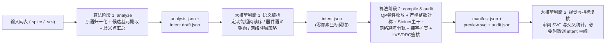

# 模算协同颗粒度规范（LLM × 确定性算法分工设计）

本工具的核心设计原则是：**不让大模型猜坐标，也不让死板算法猜电路意图。**

自动生成电路原理图长期存在两个极端：
- **纯大模型直出坐标（过细颗粒度）**：让大模型直接输出器件 `(x, y)` 与导线折点列表，极易出现引脚偏一格悬空、异网线段共线短路、参数文字重叠和大量无效 Token 消耗。
- **纯算法黑盒一键排布（过粗颗粒度）**：纯图论启发式可以识别共源/共栅局部对，但在真实模拟电路中很难可靠区分“偏置产生列 vs 主放大通路 vs 共模反馈（CMFB） vs 启动电路”，也无法根据视觉审美决定“米勒补偿电容应该水平跨接两级，还是垂直落地”。

为此，`10_原理图绘制工具` 将整个原理图生成拆分为 **四段式、带显式 JSON 检查点的模算协同流水线**。

---

## 一、执行颗粒度总览

---

## 二、职责切分矩阵：什么归算法，什么归大模型？

| 环节与问题 | 执行主体 | 控制颗粒度（输入/输出字段） | 为什么这样切分最稳？ |
| :--- | :--- | :--- | :--- |
| **SKY130 原语识别与参数归一化**（`XM...` 子电路、`res_high_po` 三端多晶硅电阻、`cap_mim`、体端归属） | **确定性算法** (`parser.py`) | `NetlistCircuit` | 语法与引脚顺序完全由 PDK 模型定义决定，算法解析 100% 精确无遗漏。 |
| **局部拓扑基元候选提取**（差分对、共栅电流镜、Cascode 串叠链、串联 RC 网络、二极管连接管） | **确定性算法** (`analyzer.py`) | `candidateMotifs[]` + `ambiguitiesForLLM[]` | 先用子图匹配把客观连接特征列清，省去大模型在大网表中逐行追踪节点的负担。 |
| **功能模块划分与从左到右阅读顺序**（如 `偏置列 → 差分输入级 → 频率补偿 → 第二级放大 → 输出负载`） | **大模型自行判断** | `groups[]` (`role`, `stage_order`, `instances`) | 涉及信号正向流与反馈环的高层电路语义理解，正是大模型的强项。 |
| **器件语义朝向与桥接姿态**（差分对背靠背、镜像负载面对面共栅、米勒 `RZ+CC` 水平跨接 `horizontal_l2r`） | **大模型自行判断**（算法提供安全默认） | `orientations{}`（仅限语义枚举，禁止填角度/偏移） | 决定图面是否符合模拟工程师手绘审美；限定为 6 种语义枚举后，大模型零坐标错误。 |
| **网络视觉降噪与端口贴靠策略**（跨全图偏置走外围母线 `perimeter_bus`、差分输入用 `near_pin` 就近接入、电源用局部重复抽头 `supply_local`） | **大模型自行判断 + 算法交叉提示** | `netPolicies{}` + `portSides{}` | 模拟图清爽的核心在于“不把偏置和电源画成横穿核心的蜘蛛网”，需要结合电路角色权衡。 |
| **符号/参数文字包络计算与双向间距优化**（撑开防重叠 + 组内收紧 + 组间留白 + 差分尾流严格整数对称） | **确定性算法** (`placer.py` 凸二次规划 QP) | 精确整数网格坐标 `(x, y)` | 连续二次规划 + 保对称整数化可在毫秒级同时满足全部不等式与对称等式。 |
| **多端 Steiner 主干、正交避障布线、平行走廊分轨推开（Edge Nudging）与拥塞自动扩宽** | **确定性算法** (`router.py`) | `routes[]`, `junctions[]` | 网格 A* 与走廊轨距约束从构造上杜绝穿器件、压参数字、异网共线和歧义拐点。 |
| **LVS 电气等价、Virtuoso 拆网预检与可读性 DRC 统计** | **确定性算法** (`auditor.py`) | `audit.json` (`metrics`, `findings`, `llmRefinementSuggestions`) | 100% 拦截漏连、错连、内部网断路和几何违例，并把交叉热点转成文字建议反馈给大模型。 |
| **多模态读图终审与局部拓扑迭代**（看 `preview.svg` 是否顺眼、是否需要翻转某支路消除剩余交叉） | **大模型自行判断** | 修改 `intent.json` 中 1～3 个枚举项并重跑 `compile` | 算法保证“合法且无碰撞”，大模型把关“电路叙事清晰、一眼看懂信号流”。 |

---

## 三、严格红线：大模型不应直接介入的操作

1. **禁止手写或手工微调 `manifest.json` 中的数值坐标**：一旦人工改偏 `sourcePoint` 哪怕 1 格，就会破坏 `virtuoso-bridge-lite` 中 `solve_exact_geometry` 的水平/垂直硬等式或导致 Virtuoso `schCheck` 断网。所有构图调整一律通过修改 `intent.json` 后重跑 `compile` 完成。
2. **禁止为减少交叉而删减真实网络或合并不同器件**：当某条偏置线横穿多级产生交叉时，只允许将其设为 `perimeter_bus`（外围汇流母线）或（仅当其本身为顶层端口时）设为 `local_repeat`，严禁改动网表电气拓扑。
3. **禁止猜测未核实的商业或实装 PDK 引脚偏移**：离线排图与 SVG 渲染可使用 `pdk/sky130_process_map.json` 标准网格模板；一旦需要向真实运行的 Virtuoso OA 库写入，必须先在当次授权下运行 `probe-pdk --live` 核对目标库符号的真实 `pinOffsets` 与 CDF 参数名。

---

## 四、典型两轮协同闭环示例

以 `examples/sky130_two_stage_ota.spice`（12 器件两级米勒补偿运放）为例：

1. **算法初探**：运行 `python -B schem_gen.py analyze examples/sky130_two_stage_ota.spice --out work_ota`，算法自动识别出差分对 `(M1, M2)`、有源镜像负载 `(M3, M4)`、偏置镜 `(MB0, M5, M7)` 与串联 RC `(RZ, CC)`，并在 `ambiguitiesForLLM` 中提示跨 3 组的 `vbias_n` 走线策略与级间顺序。
2. **大模型决策**：大模型确认 `[bias_gen -> input_diff -> miller_comp -> gain_stage2]` 阅读序，指定 `RZ` 与 `CC` 采用 `horizontal_l2r` 水平桥接第一级输出 `vout1` 与第二级输出 `VOUT`，将差分输入端口 `VINP`/`VINN` 设为 `near_pin` 就近贴靠栅极，`vbias_n` 设为 `perimeter_bus` 走底部母线。
3. **算法编译与签核**：运行 `compile`（耗时 `< 0.3s`），生成 `manifest.json` 与 `preview.svg`。`audit.json` 报告：LVS 电气等价 `PASS`、Bridge 精确几何违规 `0`、压字/穿模/共线 `0`、**全图异网交叉数 `wireCrossingCount = 0`**，一轮直接收敛。
